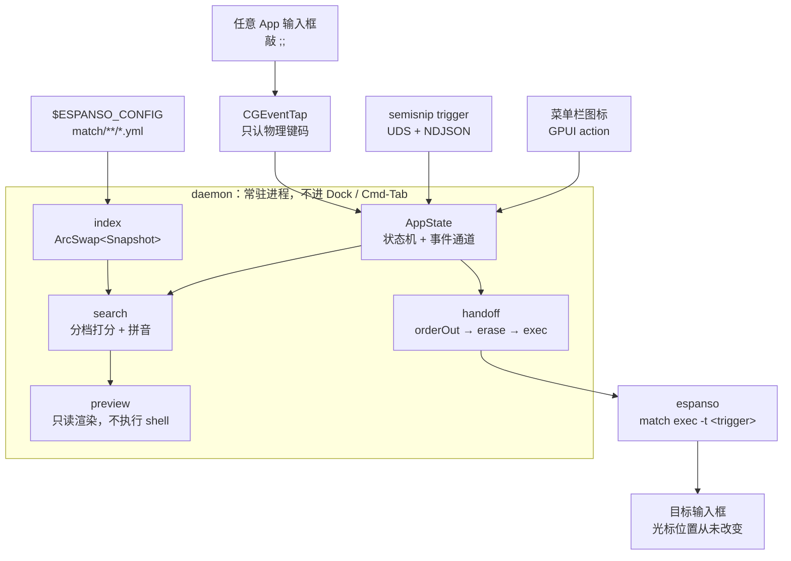

# semisnip


**espanso 的片段检索层。** 敲 `;;` 打开一个不抢焦点的小浮层，边打边过滤、右侧预览，回车把选中的 trigger 交回 espanso 求值并注入。

```
任意输入框  →  ;;  →  过滤 + 预览  →  回车  →  espanso 展开
```

> 名字是 **semicolon + snippet**：`semi` 取自 semicolon（分号，也就是触发符 `;;`），`snip` 取自 snippet（片段）。两截一拼正好是「用一个分号去取一条片段」，而图标里的斜体 `I` 就是敲分号的那根光标。

semisnip 不存片段、不渲染变量、不注入文本——这些仍然全部由 espanso 负责。它只替换 espanso 自带的搜索框那一层。

## 为什么不用 espanso 自带的搜索框

| | espanso search bar | semisnip |
|---|---|---|
| 焦点 | 抢焦点，目标 App 失焦 | 非激活浮层，目标 App 全程不失焦 |
| 数据 | espanso 运行时 | 直接读 `match/**/*.yml`，文件改动即热更新 |
| 检索 | 简单子串 | 分档打分 + 使用频率 + 拼音全拼/首字母 |
| 预览 | 无 | 只读预览，`shell` / `script` 绝不执行 |
| 展开 | 自己注入 | `espanso match exec -t <trigger>`，交回 espanso |

## 快速开始

需要 macOS 与 espanso 2.4+（可执行文件在 `PATH` 或 `/opt/homebrew/bin`、`/usr/local/bin` 下）。

```bash
git clone <repo> && cd semisnip
./scripts/bundle-macos.sh --install
```

之后手动完成两步（系统不允许脚本代劳）：**系统设置 → 隐私与安全性 → 辅助功能** 里勾选 `Semisnip`，然后 `espanso restart`。最后体检：

```bash
semisnip doctor
```

看到 `全部正常。` 即可使用。安装脚本的每一步、签名与权限问题、`command not found` 的补救，见 **[安装](docs/install.md)**。

## 使用

| 操作 | 效果 |
|---|---|
| `;;` | 打开面板（第二个 `;` 被吞掉，第一个被回删） |
| 直接输入 | 过滤，空格分词、全部 AND |
| `↑` / `↓` | 上下选择，循环 |
| `Enter` | 交给 espanso 展开 |
| `Esc` | 关闭，并回删触发符残留 |
| `Cmd` / `Ctrl` + 任意键 | 放行给系统并关闭面板，不吞系统快捷键 |

打 `date` 就能命中 `:date`，打 `rq` 能命中「日期」（拼音索引）。过滤规则、排序权重、三种唤起方式见 **[使用](docs/usage.md)**。

## 命令

| 命令 | 用途 |
|---|---|
| `semisnip doctor` | 体检：espanso / 权限 / 索引 / daemon |
| `semisnip trigger` | 请求打开面板（不切回输入框也能开） |
| `semisnip reload` | 重建片段索引 |
| `semisnip config` | 查看与修改配置 |
| `semisnip match` | 看/改写进 espanso 的 `semisnip.yml` |
| `semisnip log` | 看 daemon 日志（`-f` 跟随、`-l warn` 过滤） |
| `semisnip completion` | 给当前 shell 装补全 |
| `semisnip uninstall` | 卸载（默认只演练） |

不带参数时**只打印帮助**——daemon 是常驻进程，会抢键盘、要授权，不该是一条裸命令的默认后果。完整命令树、各子命令的行为与校验规则见 **[命令行](docs/cli.md)**，配置字段见 **[配置](docs/configuration.md)**。

## 架构



输入端三条路（键盘 tap、CLI、菜单栏）汇进同一个事件通道，片段只从 espanso 的 match 目录读进索引；daemon 内部单向：索引 → 检索 → 预览，选中后交给回传。模块之间只靠 `Snapshot` 和一个 `matched_trigger` 字符串耦合。

面板基于 `NSPanel` + `NonactivatingPanel`，浮在最前但不激活 App——这是「回车后不需要还原前台」的前提。daemon 不进 Dock、不进 Cmd-Tab，只在菜单栏留一个图标。详见 **[架构](docs/architecture.md)** 与 **[菜单栏与图标](docs/tray.md)**。

## 文档

| 文档 | 内容 |
|---|---|
| [安装](docs/install.md) | 前置条件、打包脚本做了什么、辅助功能授权、签名与分发 |
| [使用](docs/usage.md) | 按键、过滤与排序、预览、三种唤起方式、中文输入法 |
| [配置](docs/configuration.md) | `config.yml` 全部字段、schema 补全、`config` 子命令、本地文件清单 |
| [命令行](docs/cli.md) | 命令总表，`match` / `completion` / `log` / `uninstall` 细节 |
| [架构](docs/architecture.md) | 数据流、模块边界、触发与焦点、回传顺序、数据源、预览安全边界 |
| [菜单栏与图标](docs/tray.md) | 为什么不在 Dock、菜单项、图标生成方式、图标没出现怎么查 |
| [故障排查](docs/troubleshooting.md) | 现象对照表、已知限制 |
| [开发](docs/development.md) | 测试、本地调试、打包、改动约定 |

## 已知限制

- **不能用输入法打中文过滤词**：非激活面板拿不到 IME 会话，中文标签靠拼音索引弥补。
- **中文输入法下触发串可能是全角**：`；；` 与 `;;` 不是同一个字符串，触发时切到英文输入法最稳。
- **仅 macOS**，且 ad-hoc 签名只够本机自用，每次重建都要重新授权辅助功能。

完整清单见 **[故障排查 · 已知限制](docs/troubleshooting.md#已知限制)**。

## License

MIT
