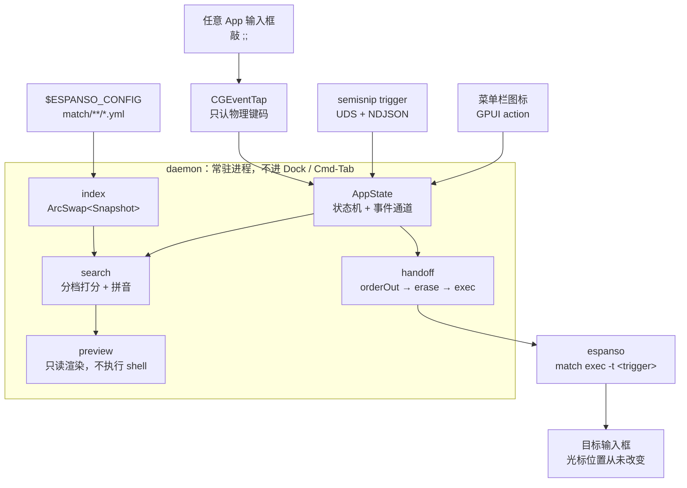
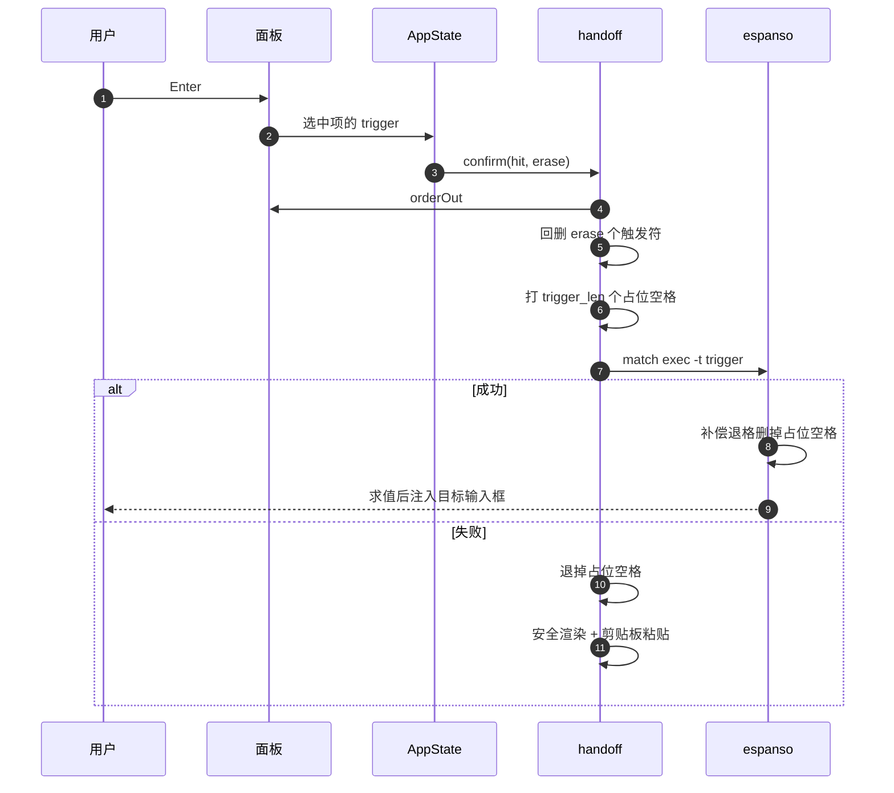

# 架构

## 数据流

三条输入（tap 吞键、CLI 的 UDS 消息、菜单栏的 GPUI action）走的是同一个事件通道，所以「敲 `;;`」「`semisnip trigger`」「点菜单」在 daemon 看来没有区别。daemon 内部单向：索引 → 检索 → 预览，选中后交给回传。模块之间只靠 `Snapshot` 和一个 `matched_trigger` 字符串耦合。

## 模块与边界

| 模块 | 文件 | 职责与边界 |
|---|---|---|
| 触发 | `trigger/tap.rs`、`trigger/machine.rs`、`trigger/keymap.rs` | 只认物理键码，不知道片段存在；命中时**一个键都不吞**——触发串的所有字符都落进文档，`erase` = 触发串全长。同一个 tap 还订阅鼠标按下——只为「点面板外 = 收起面板」，判定靠开窗时记住的窗口矩形，鼠标事件永远放行 |
| 通信 | `ipc/proto.rs`、`ipc/server.rs`、`ipc/client.rs` | UDS + NDJSON，带版本号；单实例，daemon 不在时由 CLI 自愈拉起 |
| 数据 | `index/loader.rs`、`index/service.rs` | 唯一读 YAML 的地方，产出 `Arc<Snapshot>`；后台重建，UI 永远只读 |
| 检索 | `search/score.rs`、`search/query.rs`、`search/pinyin.rs` | 纯函数、零 IO、确定性排序 |
| 预览 | `preview/vars.rs` | 只吃 `&Snippet`，**绝不执行 shell/script** |
| 回传 | `handoff/mod.rs`、`handoff/inject.rs` | 只认 `Hit` 与 trigger 字符串，不关心 YAML 结构 |
| espanso | `espanso/cli.rs` | 定位可执行文件；`match exec` / `match list --json` 的唯一出口 |
| 路径 | `paths.rs` | 全项目唯一知道「东西放哪」的文件：系统目录问 `dirs`，自己的文件、`/Applications`、`/usr/local/bin`、LaunchAgent、espanso 的 `match/` 全在这里。业务模块只许调用，不许拼字面量 |
| 配置 | `config.rs`、`cli/config_cmd.rs` | YAML + 内嵌 JSON Schema（`assets/config.schema.json`）；只碰自己的偏好，不碰 espanso 的 YAML |
| 定位 | `platform.rs`、`ui/place.rs` | `platform` 只回答两个问题：每块屏在全局坐标里的矩形、插入点在哪（AX → 单行控件 → 鼠标三级退化）；`place` 把答案翻译成 gpui 要的「屏幕本地坐标 + DisplayId」，其中 `place_auto` / `place_center` 是纯函数、可单测。全局 ↔ 本地的换算只发生在这一层 |
| 界面 | `ui/window.rs`、`ui/view.rs` | 面板：`WindowKind::PopUp`（NSPanel + NonactivatingPanel），不处理键盘；右上角 `✕` 是面板内唯一的可点元素，点面板外由 tap 的鼠标监听收起——两路都只投事件，收尾逻辑仍归 scheduler。`tap_ok` 为假时整块换成「需要授权」页——没接上键盘还画一列候选，等于骗人 |
| 设置 | `ui/settings.rs` | 普通窗口 + gpui-component 的 `Settings`；字段直接读写一份全局 `SettingsState`，改动立即落盘并投 `ConfigChanged` |
| 引导 | `ui/onboarding.rs` | 四步首次引导；体检是打开时的一次快照（`espanso --version` 要起进程），走完写 `onboarded` |
| 窗口公共 | `ui/mod.rs` | 主题跟随系统外观（`sync_theme`）、`reveal()`、打开辅助功能设置页 |
| 菜单栏 | `tray.rs` | NSStatusItem + 原生菜单；模板图（深浅色自动反色），菜单项经 GPUI action 回到 scheduler 的事件通道。第一项按窗口句柄在「打开 / 关闭片段面板」之间切换——tap 不可用时它是收面板的唯一出口，所以开合之后要 `refresh` |
| 图标 | `mark.rs` | 「斜体 `I` + `;;`」的解析式几何；`sample()` 会区分字母与触发符，所以应用图标能双色、菜单栏仍走单色模板图。运行期与构建期编译的是**同一份文件** |
| 装配 | `app/state.rs`、`app/scheduler.rs`、`app/event.rs` | 状态机与事件循环；`Event::ConfigChanged` 是"窗口改了配置 → 面板换值"的唯一通道；另有 tap 看门狗：每秒对齐 `tap_ok`，没就绪就每 5 秒试一次重装（授权补上之后不用重启 daemon） |
| 命令行 | `cli/mod.rs`、`cli/match_cmd.rs`、`cli/completion.rs`、`cli/config_cmd.rs`、`cli/log_cmd.rs`、`cli/uninstall.rs` | clap 定义命令树；补全脚本由同一份定义生成，不会和实现走偏 |

## 触发与焦点

面板是 `WindowKind::PopUp`，在 macOS 上对应 `NSPanel` + `NonactivatingPanel`：浮在最前、跟随所有 Space，但不激活 App。目标 App 的光标位置全程不变，这是回传能「零折返」的前提——不需要还原前台，也不需要 espanso 官方那套 200ms 等待。

按键由 CGEventTap 吞下后直接改 `AppState`，不经过 gpui 的键盘事件，因此面板本身不接收焦点。

代价是拿不到 IME 会话：过滤只能走物理键码映射，中文过滤词要靠拼音索引。见 [故障排查 · 已知限制](troubleshooting.md#已知限制)。

面板不抢焦点，也意味着**点别处不会自动收起来**：`NonactivatingPanel` 不会收到 `resignKey`，光标从来没在它身上。所以收面板要靠自己判：tap 订阅了鼠标按下，拿 `CGEventGetLocation` 与开窗时记下的窗口矩形比一比，落在外面就投 `Event::ClickOutside`。两个细节值得写下来：

- 鼠标事件**一律放行**，绝不吞——面板里还要点 `✕`、点授权页的按钮，抢了点击就全废了；
- 收面板**不动目标文档**，现在所有关闭路径都如此：触发键一个不吞，文档本来就是用户打的原样，取消不需要任何合成按键（历史上这里有一套"补回被吞触发键 + 触发静默窗口防死循环"的机制，不吞键之后整体消失了）。

## 回传顺序

只有一种正确顺序，写在 `handoff::confirm` 里：

1. 面板 `orderOut`（由调用方先行关闭）
2. 回删落进文档的触发符（`erase` 个——触发键不吞，它们真的在文档里）
3. 打 `trigger_len` 个**占位空格**
4. `espanso match exec -t <trigger>`——espanso 按 trigger 全长回删（TriggerCompensation），删掉的恰好是那串空格，然后注入展开文本
5. 失败时：先退掉占位空格（IPC 没成功就没有补偿退格来收走它们），`allow_paste_fallback` 为真则安全渲染 + 剪贴板粘贴，否则只记日志

**为什么用占位空格、而不是吞掉补偿退格。** 早期版本在 `match exec` 前预告"接下来
800ms 内有 `trigger_len` 个 espanso 退格，tap 帮我吞掉"。这在单独使用时工作正常，
但 espanso 的注入管线是串行的，补偿退格到达的时机不可预估——前面压着一轮慢展开
（shell 变量一跑几百毫秒）时可能 800ms 之后才来。espanso 原生触发（`:shell`）与
面板确认**交替使用**时，前后两轮的注入在时间上重叠，预算必然误伤：原生轮的退格
被吞 → 文档留半截触发词（表现为"删除的字符数量不足"）；原生轮的展开文本一到达
又把预算清空 → 真正的补偿退格放行 → 删掉光标前的真实字符（表现为"展开结果与
预期不符"）。占位空格不依赖任何时序假设：退格无论何时来、属于哪一轮，删的都是
恰好 `trigger_len` 个可丢弃的空格。tap 那边配套的规则是"外部进程合成的事件一律
放行，面板开着也一样"（见 `trigger::tap::route_panel_key`）。

代价有二，都写在 [已知限制](troubleshooting.md#已知限制) 里：慢片段展开期间用户能短暂看到那串空格；这期间按退格会自己吃掉空格，让补偿退格多删字符。

`match exec` 没有回执，失败只能靠退出码和 `espanso log`。

**取消是纯关闭。** 触发键一个不吞（见 [触发与焦点](#触发与焦点)），文档里本来就是用户打的 `;;`，取消只是收起面板——零合成按键。这意味着取消路径天生免疫时序问题：不需要"先关窗再合成"的顺序约束，也没有"补回去的字符又被自己的 tap 吃掉"的循环风险。

## 两条回传协议

- **semisnip → espanso**：只有一个 `espanso match exec -t <trigger>`。协议里唯一必须精确传递的是「命中了哪个 trigger」，不是片段 id。
- **espanso → semisnip**：仅在降级路径存在。没有辅助功能权限时，espanso 的 shell match 调用 `semisnip trigger --origin espanso` 唤醒面板。该 match 的 stdout 必须严格为空。

降级匹配（`match/semisnip.yml`）有两个刻意的设计，改之前想清楚：

- **触发串比配置的多打一个末字符**（`;;` → `;;;`）。触发键不吞，触发串会完整到达 espanso——如果降级匹配也用 `;;`，每次打开面板它都会命中并把文档里的分号擦掉。多出的那个字符在面板打开期间永远凑不齐（面板吞掉一切物理按键），所以 tap 在线时这份匹配等于不存在。
- **`replace` 把触发串原样注回**（`;;;{{output}}`）。espanso 命中被动匹配会先按 trigger 全长回删，注回才能让文档保持不动。零损伤：espanso 不处理自己注入的事件（否则自我重叠的 trigger 都会死循环），semisnip 这边外部注入也不进触发状态机（见 `trigger::tap`）。

## 数据源

- 递归读取 `$ESPANSO_CONFIG/match/**/*.{yml,yaml}`
- `_` 开头的文件不加载（`_manifest.yml` 靠这条排除）
- `packages/` 下的片段同样会被收进来
- 启动时与 `espanso match list --json` 做一次交叉校验，以 espanso 眼中的 trigger 集合为准
- 监听 `match/` 目录，300ms 防抖后后台重建索引；也可以 `semisnip reload` 手动刷新
- 重建失败时保留旧快照，面板不会突然空掉

espanso 的 `filter_class` / `filter_exec` 这类 app-specific 规则目前**没有复刻**，靠 `match list --json` 的交叉校验兜底。

## 预览的安全边界

预览与展开是两条完全不同的路径。展开由 espanso 真求值；预览只做无副作用的近似：

| 变量类型 | 预览行为 |
|---|---|
| `echo` | 显示常量值 |
| `date` | 按 `format` / `offset` 实际算出日期 |
| `random` | 显示候选列表 |
| `clipboard` | 只显示字符数（`preview_clipboard` 为真时才显示前 80 字） |
| `shell` / `script` | **不执行**，占位符原样保留，并显示红色告警与命令首行 |
| `choice` / `form` | 显示候选数量 / 提示会弹表单 |
| 未知类型 | 保留占位符并告警 |

## 菜单栏与图标

daemon 不进 Dock、不进 Cmd-Tab，只留一个菜单栏图标。见 [菜单栏与图标](tray.md)。
