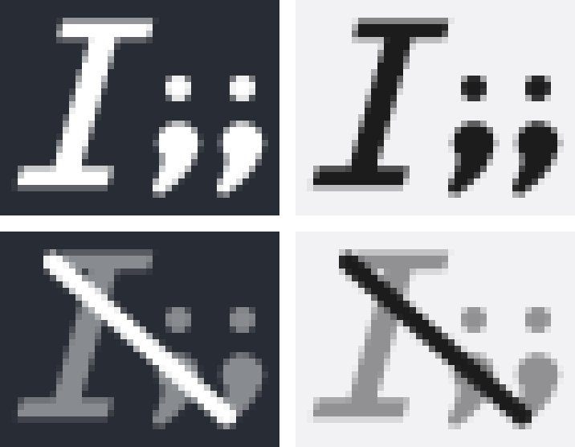

# 菜单栏与图标

daemon 是常驻进程，但**不进 Dock、不进 Cmd-Tab**：`Info.plist` 里 `LSUIElement=true`，二进制启动后还会再调一次 `set_activation_policy(Accessory)`——只靠 plist 不够，gpui 启动时会把策略按自己的默认（Regular）设回去。

验证方法：

```bash
lsappinfo list | grep -A3 -i snipshot   # 应看到 type="UIElement"
```

## 菜单

用户能看见它的地方只有菜单栏那一个图标（模板图，深浅色自动反色）：

```
打开片段面板        ← 和 `;;` 等价，只是不用切回输入框
──────────
重建索引
──────────
打开配置…           ← 用系统默认程序打开 config.yml
打开 snipshot.yml…  ← espanso 的那个降级触发定义（不存在时打开其目录）
打开日志…
──────────
退出 snipshot       ← 走 Shutdown，先关面板再退，launchd 不会把它拉回来
```

菜单项不是直接调系统 API，而是发 GPUI action 回到 scheduler 的事件通道——和 `snipshot trigger`、键盘 tap 走的是同一条路，所以「点菜单」和「敲 `;;`」不会有行为差异。

## 标记

标记是「斜体 `I` + `;;`」：`I` 是光标，`;;` 是触发词，合起来就是产品那一句话。菜单栏用的也是它——同一个程序在两个地方必须是同一个记号。


菜单栏图标是同一个标记，只是更小（15pt 高、按比例宽 20pt）：



## 图标是生成的，仓库里不放二进制素材

形状在 `src/mark.rs` 里是一组解析式矩形，`build.rs` 在构建期把它渲染成 PNG 和 ICNS。所以：

- 改设计只改 `src/mark.rs` 里的几个常量，`cargo build` 自动重画；
- 每次构建都从零采样（4×4 子样本算覆盖率），16px 和 1024px 用的是同一套线条，不存在「大图缩下来发糊」；
- 不需要 Pillow、也不需要 `iconutil`——ICNS 就是「魔数 + 一串 (类型, 长度, PNG)」，`build.rs` 里手拼，Linux 上 `cargo build` 也不会断。

`build.rs` 用 `#[path = "src/mark.rs"] mod mark;` 引入同一份文件，`tray.rs` 用 `crate::mark` 引入。构建期画图标和运行期画菜单栏图标，编译的是**同一个文件里的同一组常量**，改一次斜度两边一起变。

### 产出

都在 `packaging/macos/`（内容没变时不重写，免得刷 mtime）：

| 文件 | 用途 | 版本控制 |
|---|---|---|
| `AppIcon.icns` | 10 个槽位（16…1024，含 @2x），`CFBundleIconFile` 指向它 | **忽略**，构建期重新生成 |
| `icon-preview.png` | 512px 预览，就是上面第一张图 | 入库，README / 本文引用 |
| `tray-preview.png` | 菜单栏图标的深浅底色对照（放大 8 倍，用来看 15pt 下认不认得出来） | 入库，同上 |

### 小尺寸会少画一笔

16px 的分号圆点只有 1.15px，画出来不是「;」而是一团灰，还把 `I` 的轮廓拖脏。所以 `mark::hit()` 会按框宽判断：圆点不足 1.5px 就只画 `I`。32px 的圆点是 2.3px，两个分号正常出现。

## 图标没出现？

先看菜单栏最左侧、刘海右边有没有一个 `«` 双箭头。有的话说明菜单栏已经排满，macOS 把新图标折叠进溢出区了——新建的状态项永远排在右边那组的末尾，也就是最先被折叠的那个。

处理：随手退出一个菜单栏常驻 app，或按住 ⌘ 拖动图标调整位置，`I` 就出来了。

这和 snipshot 本身无关：用纯文本状态项做的最小 AppKit 探针在同样环境里也一样看不见。另一个坑是**不要用窗口枚举判断**——这台机器上 `CGWindowListCopyWindowInfo` 连探针的 layer-25 状态栏窗口都枚举不到，「列表里没有 Snipshot」不能当作失败证据。
